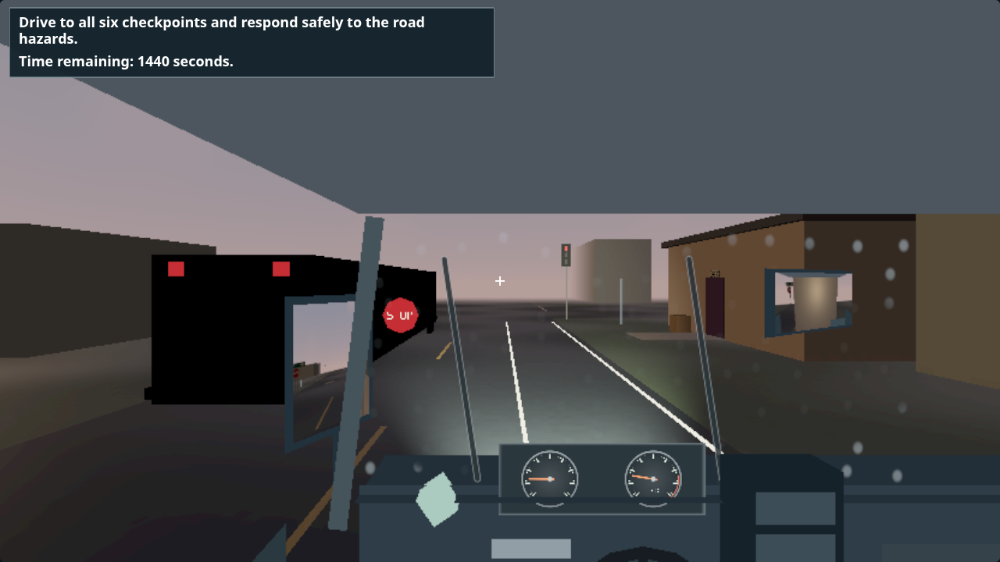
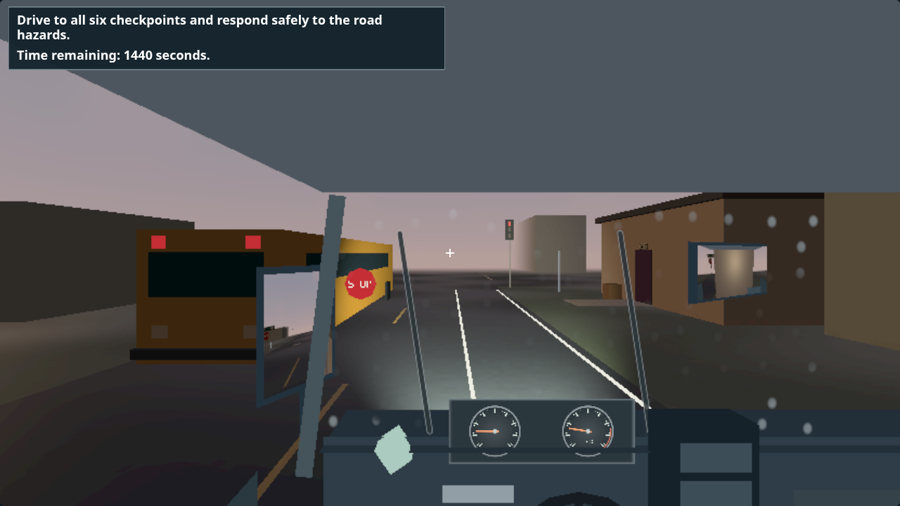
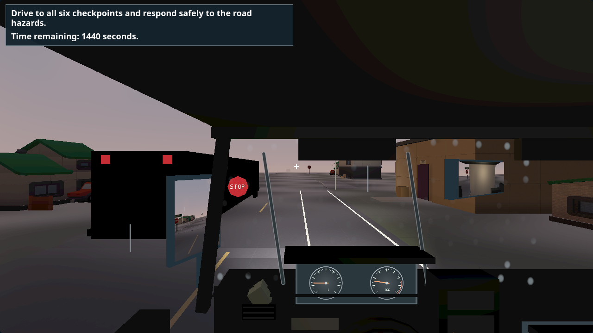
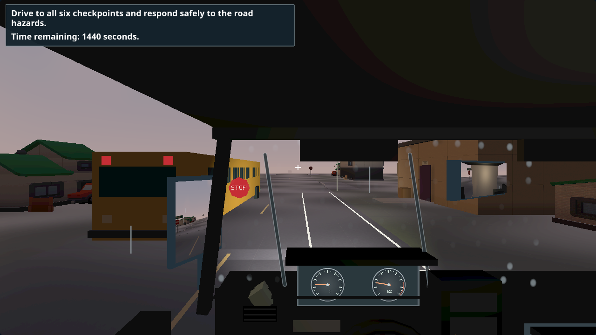

# Drill bus colour correction, 23 October 2026

Screenshot review found the original procedural drill bus rendered black. Its Lambert material requested vertex colours from shared cube/plane geometry with no colour attribute, multiplying the per-instance paint by an absent input. Removing that flag restores the existing yellow body and blue windows. No geometry, texture, asset, light, pass, motor, score, control or parking predicate changes.

The new shader-input regression fails on the original material and passes after the correction in both Low and High. All 85 non-browser suites pass at the corrected frozen candidate 85b248bf. Eight fresh fpbench views (bus clue/after across loaded Low/High, larger-text/colour/reduced Low and fallback Low) pass the original visibility/isolation proofs and resource ceilings. The ordinary fixed gate and its default view list are unchanged.

These are targeted bus views. The earlier full 72-view driving matrix and native drives retain their own source scopes. Lower memory/triangle peaks in a two-view sweep are not a performance improvement over the full matrix. No new Intel-laptop FPS claim is made; O-1 remains.

| Profile | Before | Corrected |
| --- | --- | --- |
| Low |  |  |
| High |  |  |

The before images are the corresponding fixed views from the b7dc5de8 matrix. The after images use the corrected candidate with the same view setup. Both matched Low/High comparisons were inspected. The remaining C-39 feature contract questions stay with Claude, while C-40 continues on its own branch.
