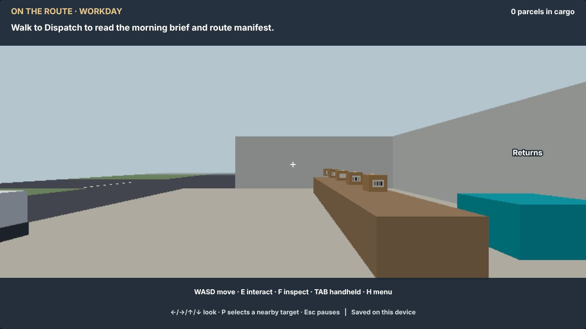
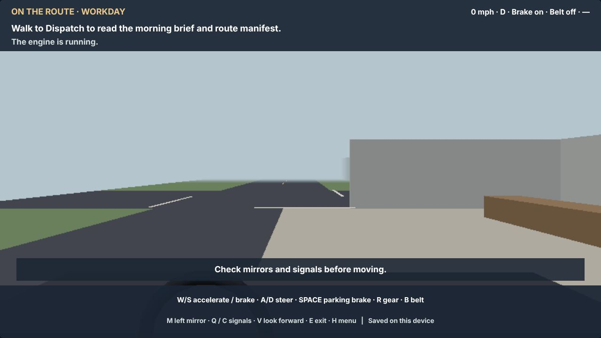
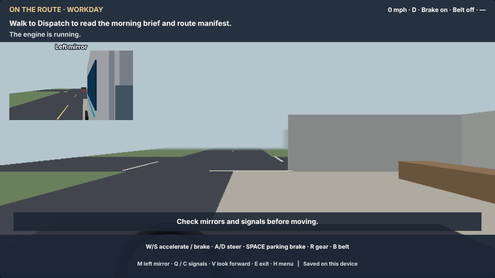
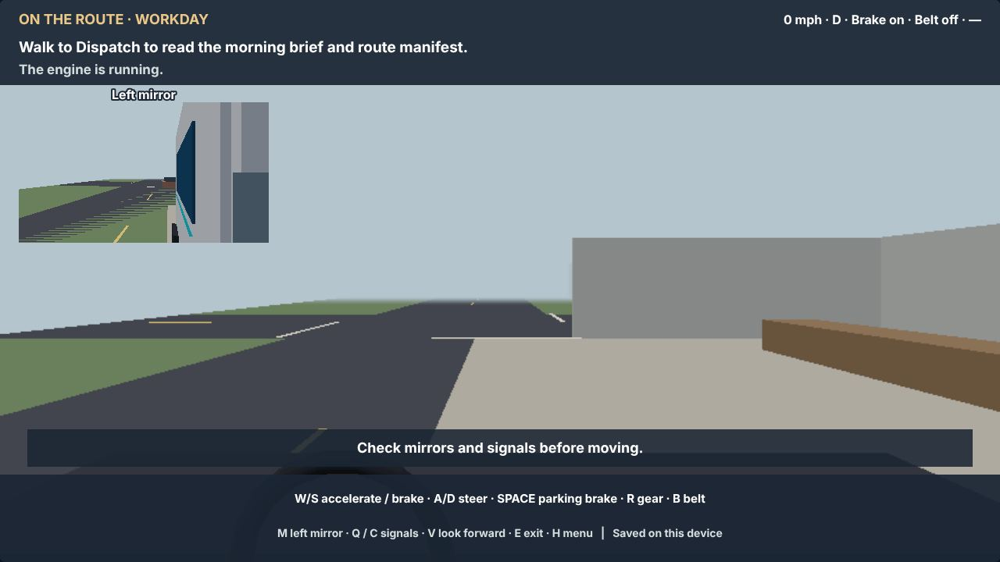
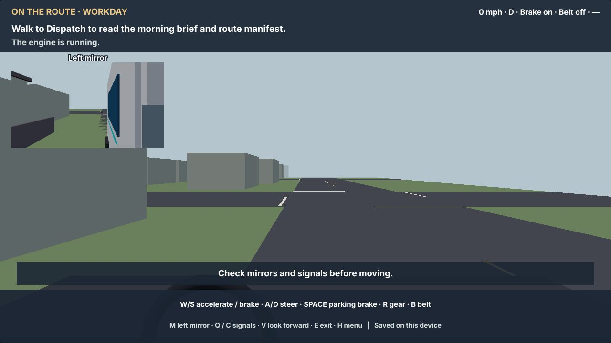
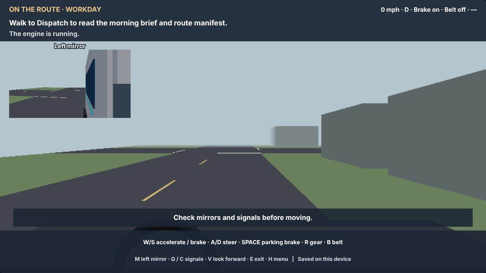
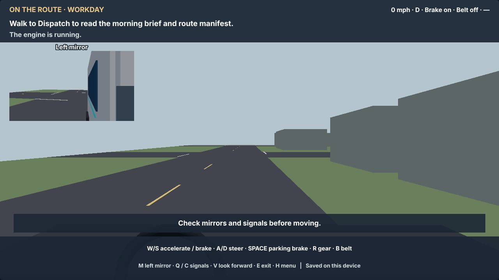
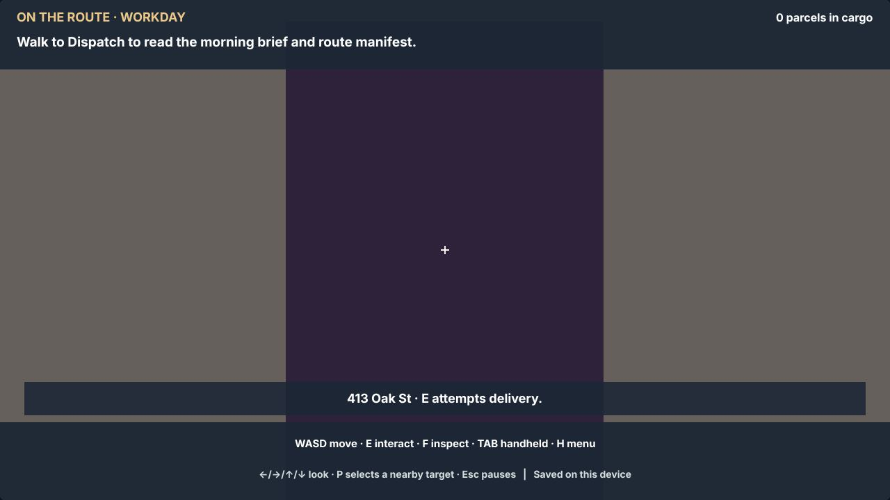

# Review set 6: fixed views

Captured 2026-10-17 from `first-person.html` on the first campaign day,
Low and High graphics, by `node test/tools/review-set.js 6`. The same views are taken at every milestone: open
the same file in the previous set to compare. These are software-rendered (no graphics card), so they show the look,
not the frame rate.

| View | What to look at | Low | High |
| --- | --- | --- | --- |
| depot | The depot in the morning: the van, the shelves, Dispatch |  |  |
| cab | Sitting in the cab: the dashboard, the controls, the view ahead |  |  |
| mirror | The mirrors from the driver's seat |  |  |
| street | Driving along the first street towards a junction |  |  |
| reverse | Reversing: the rear camera and the guidelines | not built yet | not built yet |
| stop | Parked at the first stop |  |  |
| doorstep | At the first door |  |  |
| satnav | The sat nav with the route | not built yet | not built yet |
| night | Driving at night with headlights | not built yet | not built yet |
| damage | The walk-round damage report | not built yet | not built yet |

No page errors while capturing.
