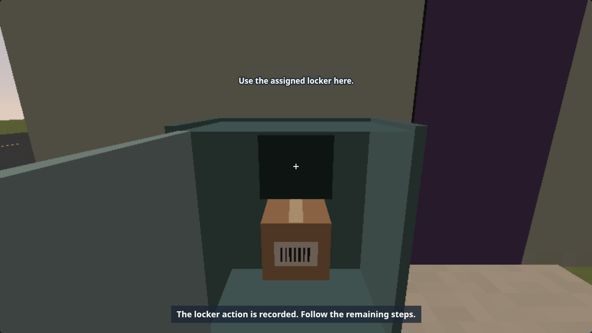
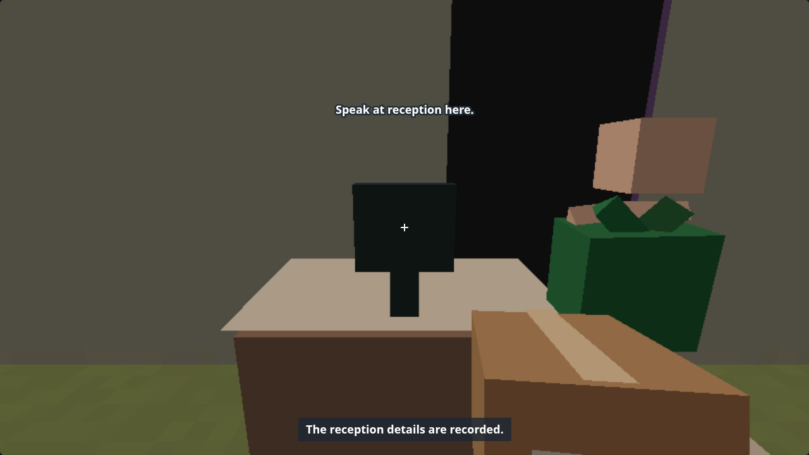

# C-33 physical stops: progress evidence

19 October 2026. `codex/c33-richer-stops`, from pilot `370fd59`, after merged C-28.
**Blocked; not ready for merge.** The live locker policy question is in Claude's inbox.
Remaining browser validation is running again after approval recovery. C-34 continues
independently while these external dependencies are unresolved. Earlier Git push/fetch
attempts failed with review-model capacity, then recovered after
the environment restart at 06:18 UTC. Fetch confirmed pilot `370fd59`, and C-33 progress
pushed through `d47c09f`. C-34 has separate pushed model progress through `7e1cec3`.

Intercoms and solid gates, named reception signatures, physical locker custody/hinges,
failed-delivery cards/retention/booking and existing animated residents are integrated.
Original ID/signature/dog/address/dispatch requirements remain. No signed parcel becomes
an unattended locker delivery. The first two days and unmarked saves keep their flow.
[Behaviour and policy question](../../3D-STOPS.md).

Runtime `b1d01d6` fixes intersecting porch furniture and skips gates at blocked driveways.
`e61993e` adds recovery tests and High wait diagnostics without changing runtime. Earlier
resource/browser evidence names its own revision. [Manifest and hashes](c33-physical/manifest.json).

## Completed checks

- 201 main Node cases; 194 inherited cases in 15 separate processes. Asset suites run
  separately so their shared Three.js loader realms do not interfere.
- Thirty model journeys: 150 stops, 759 restored checkpoints; retained parcels return
  through cargo and Returns to Dispatch. SCORM score round trips peak at 1,876/4,000;
  the new owned state peaks at 1,061 characters. Travel positions are fixtures.
- Loaded and fallback CPU sweeps: 264,000 native-plan views each, respectively
  59 calls / 2,398 triangles and 56 / 2,120. Low ceilings remain 64 / 2,500.
- Low browser: all 24 English/Tamil normal/larger workflows, 596 checks before furniture
  polish. Eight affected reception/locker workflows pass 200 further checks afterwards.
  Real remapped keys, barcode holds, signatures, spoken prompts and layout bounds pass.
- Separate existing-catalogue i18n and 20 changed-JS syntax checks pass. Three SCORM
  1.2/2004 packaging checks passed at scene revision `18d8658`; no package launch is claimed.

## Focused rendered resources

These are **28 views at pre-polish `18d8658`**, seven per profile. They include the
physical protocols, retained exception and native signed Later reverse/night stress.
This is not the complete 101-view gate. No new model, image, target or pass was added.
Low's marked-day town decoration allowance is 120 triangles; High detail is unchanged.

| Profile | Calls | Triangles | Three textures | Attachment bytes | Phaser bytes, mipmap estimate |
| --- | ---: | ---: | ---: | ---: | ---: |
| loaded-low | 48 | 1,830 | 2 | 3,557,376 | 2,916,688 |
| loaded-high | 70 | 218,543 | 3 | 11,239,424 | 7,885,104 |
| accessible-low | 48 | 1,830 | 2 | 3,557,376 | 3,254,560 |
| fallback-low | 41 | 1,654 | 2 | 3,557,376 | 2,859,344 |

[Four profiles](c33-physical/c33-physical-quality.json),
[loaded sweep](c33-physical/c33-loaded-final-geometry.json),
[fallback sweep](c33-physical/c33-fallback-final-geometry.json),
[main tests](c33-physical/c33-final-node.log),
[inherited tests](c33-physical/c33-final-cpu-status.json),
[model journeys](c33-physical/c33-campaign-journeys.json),
[Low workflows](c33-physical/c33-low-before-polish.json),
[affected Low rerun](c33-physical/c33-low-polish-stops.json).
Cloud SwiftShader resources do not establish Intel 60 fps; O-1 remains.

## Captures

Furniture captures below use the final runtime. The gated/intercom/exception views
come from the preceding full Low run; those day-three fixtures are unchanged by polish.
New English is still awaiting Claude's translation; Tamil captures exercise the existing
translated controls and fonts plus English fallback for new sentences.






[Gated site](c33-physical/c33-low-en-large-gated-physical.png),
[intercom](c33-physical/c33-low-ta-large-intercom-physical.png),
[retained exception](c33-physical/c33-low-ta-large-failed.png).

## Remaining work and reproduction

The first High workflow timed out waiting for the intercom while video recording;
[failure](c33-physical/c33-high-recording-failure.json). The first no-recording diagnostic
rerun and recovery commands did not run. Automatic approval review rejected both attempts
because its review model was at capacity; neither command executed. This is an approval
service failure, not a safety finding. The owner has been asked for review capacity or
approval. Review capacity recovered at 06:18 UTC; the sequential no-recording High,
recovery, full-resource and inherited browser/golden checks are now running. The first
five English-normal High workflows pass ([partial log](c33-physical/c33-high-rerun-progress.log)),
The full 101-view resource gate has since passed (below); full High gameplay is
still incomplete.
Do not mark review until the remaining gameplay checks finish and the locker policy is resolved.

Run browsers sequentially from this checkout, with a local server and the installed
`puppeteer-core` on `NODE_PATH`:

```sh
QA_BASE=http://127.0.0.1:8339 QA_GFX=high QA_LANGS=en,ta QA_TAG=c33-high-final node test/fpstopbrowser.js
QA_BASE=http://127.0.0.1:8339 QA_GFX=low QA_LANGS=en,ta QA_SIZES=large QA_KINDS=intercom,gated,reception,locker,failed QA_NEGATIVE=1 QA_TAG=c33-negative-low node test/fpstopbrowser.js
QA_BASE=http://127.0.0.1:8339 QA_TAG=c33-final node test/fpquality.js
QA_BASE=http://127.0.0.1:8339 node test/fpdoorsbrowser.js
QA_BASE=http://127.0.0.1:8339 node test/fpaccessbrowser.js
QA_BASE=http://127.0.0.1:8339 node test/fpguidebrowser.js
QA_PORT=8340 QA_GFX=low QA_FPS_FLOOR=0 node test/qa.js --only workday-3d,workday-3d-b --pass golden
```

CPU reproduction (repeat with `QA_ASSETS=0 QA_TAG=c33-fallback-final`):

```sh
QA_STOPS=1 QA_LATER=1 QA_CAMERA=1 QA_CAB=1 QA_CARGO=1 QA_MIRRORS=1 QA_REAR=1 QA_LIGHTING=1 QA_WEATHER=1 QA_TOWN=1 QA_ACTORS=1 QA_SIGNS=1 QA_NAV=1 QA_ASSETS=1 QA_TAG=c33-loaded-final node --test --test-isolation=none test/fproute.js
```

Also outstanding: the control clip, Claude's translation/layout pass, merged C-32/C-33
validation, and native Intel O-1. Shared `index.html` adds three owned script tags; the
existing C-32 script-font fallback is carried unchanged. No shared scoring/save/Settings
or i18n source changed.

## Complete resource evidence, 20 October 2026

All 101 views in four profiles pass at source `1e1c0db`, runtime `b1d01d6`.

| Profile | Views | Calls | Triangles | Three textures | Attachment bytes | Phaser bytes, mipmap estimate |
| --- | ---: | ---: | ---: | ---: | ---: | ---: |
| loaded-low | 40 | 53 | 2,386 | 2 | 3,557,376 | 3,235,467 |
| loaded-high | 25 | 98 | 220,081 | 3 | 11,239,424 | 7,972,870 |
| accessible-low | 18 | 53 | 2,386 | 2 | 3,557,376 | 3,268,112 |
| fallback-low | 18 | 52 | 2,108 | 2 | 3,557,376 | 2,910,528 |

[Raw reports, all screenshots and hashes](c33-complete/manifest.json). This completes
the resource gate, including real mirror pixels, healthy/fallback assets and no lost
contexts. It does not complete the High gameplay paths or settle live locker policy.
The browser harness now saves a report after every completed case; interrupted runs
retain their completed cases and cannot be mistaken for a full pass. Recovery cases
are proceeding in bounded English/Tamil batches. Earlier timed-out recording and
partial High logs remain scoped to their own runs.

## Recovery evidence, 20 October 2026

All ten larger-text English/Tamil error-and-recovery workflows pass **288 checks**: wrong
intercom/gate choice, reception correction, locker correction and retained-exception
recovery. Each unsuccessful intermediate state restores and emits no stop check until
the outcome. The recovered protocol keeps the wrong choice for its one failed protocol
grade while the completed delivery outcome is correct. Remapped keys, narration,
colour-blind mode and reduced motion stay enabled, with no browser errors. The locker
is still an explicit standard-service test fixture pending the live campaign policy.
[Reports, captures and hashes](c33-recovery/manifest.json). Full High gameplay, inherited
doorstep/access/guide checks and golden paths remain; the task stays blocked.
