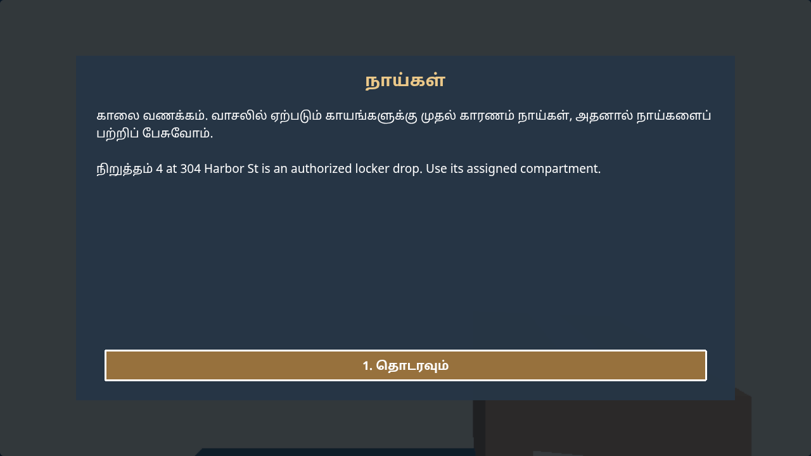
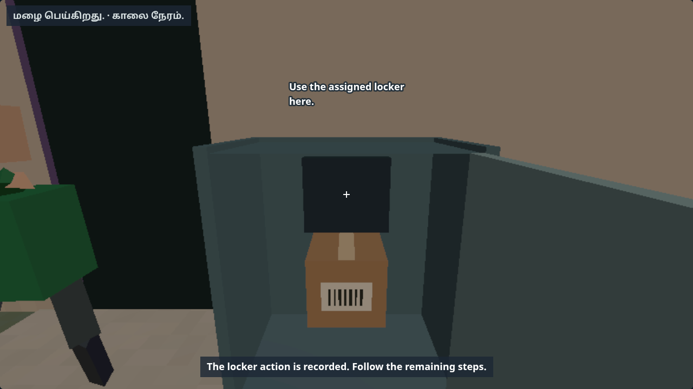

# C-33 richer stops: current progress

20 October 2026. Branch `codex/c33-richer-stops`, rebased onto pilot `a2fe57b`, including
merged C-34. **Doing; not ready for merge.** The approved live locker policy is implemented;
combined resource/gameplay acceptance continues. Sign placement and the shared dash
screen are implemented and their final audits are running.
[Behavior and ownership](../../3D-STOPS.md). [Evidence/source hashes](c33-policy/manifest.json).

## Current sign and cab checks

Source `220f2ba` reserves road-label space above the working dashboard. The sat nav and
physical reverse screen share the lower/right mount; full-size gear symbols remain on
the visible side of the shifter. No new pass, target, geometry or texture is added.
The bounded sign pool wraps at readable sizes, tries nearby clear positions and clamps
tall sentences inside the view. Labels avoid physical sign heads, mirrors, navigation
and the dashboard. The repeated 12-language, normal/larger check passes **240/240
straight-ahead approaches**, including red/amber/green, give-way and stop signs at 24 m
and 12 m; no clipped/shrunk/missing line, obscured sign/selector or browser error.

The earlier full CPU sweeps are repeated at render source `fc95b34`: **285,600 views
each**, loaded **60 calls / 2,443 triangles**, fallback **59 / 2,181**. The subsequent
`220f2ba` changes only Phaser sign placement, its tests and a state-based caption-audit
wait; the 3D render inputs are unchanged. The actual 155-view WebGL gate is still
required for the complete frame and text memory.

All **52 non-browser suites** pass: 46 directly and six scoped reruns with local-server
or subprocess permissions. Their assertions are unchanged. The final sign/cab/HUD/rear/
navigation delta has **80 affected Node cases** (the earlier batch has 79; the additional
case reserves the working dashboard). The ten page-opening Node suites, affected
browser workflows, final resource gate remain. The strict inherited audit passes **540/540 larger-text
cab, guide, traffic and damage views in all 12 languages**, with no layout/page errors.
[Current UI evidence, sources and exact scopes](c33-ui/manifest.json).

## Verified

- Source `bb20661`, before merged damage: native Low **144** and High **144** checks,
  English/Tamil at normal/larger text. The real briefing names the locker; remapped
  controls, scanner, custody, closed-door photo, reports, narration and restores pass.
- Nineteen targeted suites on the combined pilot: **299 Node cases** plus current-catalogue
  i18n. The live-locker suite's final six cases at `7122a01` include merged damage state.
  Two hundred generated plans preserve every non-locker signature/ID/dispatch obligation;
  malformed plans and checkpoint authorisation loss are rejected.
- Script-font regression: all nine Indic mappings select their installed script family,
  retaining company fallback, size and backing resolution. English/Spanish/French family
  selection is unchanged. Low Tamil normal/larger native lockers pass **72** fresh checks
  at `5f13a95`. Visual review confirms correct briefing glyphs; new sentences still use
  English fallback until Claude translates them.
- The full pre-fix combined loaded sweep fails at **2,510 triangles** (day 21, variant 10,
  loaded cargo exterior). A 960-view focused rerun with 60 decorative town triangles on
  combined damage/stop days passes at **56 calls / 2,433 triangles**. Other marked days
  retain 120 and High keeps its existing detail. The full loaded sweep then passes **285,600 views at 60 calls / 2,443 triangles**.
  The full fallback sweep passes **285,600 views at 59 calls / 2,181 triangles**.
  The 64-call/2,500-triangle Low ceilings are unchanged.




## Still required

The updated **155-view** four-profile gate (richer stops,
traffic and damage together), remaining High workflows, inherited browser regressions,
all-language sign labels and the give-way/stop-sign sight line. Fresh High Tamil native lockers pass **72 checks** at `09e98bb`; briefing/weather
captions render correct glyphs. The submenu keyboard check passes **41 English/Tamil checks**. No complete resource or
finished-task claim is made here. Native Intel O-1 remains: cloud FPS is not laptop FPS.

Claude's shared `test/paths/workday-3d.js` currently goes straight to the door/handheld.
The inbox requests physical intercom call/wait/unlock, locker open/scan/deposit/close/photo,
reception and reattempt handling while preserving signature/ID checks, so the five
workday flows can accept the new marked days. No shared QA path has been edited.

## Reproduce

Run sequentially against this checkout served locally (Chromium and puppeteer-core must
be available):

```sh
QA_BASE=http://127.0.0.1:8339 QA_GFX=low QA_LANGS=ta QA_KINDS=locker QA_LIVE_LOCKER=1 QA_TAG=c33-font-low node test/fpstopbrowser.js
QA_BASE=http://127.0.0.1:8339 QA_GFX=high QA_LANGS=ta QA_KINDS=locker QA_LIVE_LOCKER=1 QA_TAG=c33-font-high node test/fpstopbrowser.js
QA_BASE=http://127.0.0.1:8339 node test/fpkeysbrowser.js
QA_BASE=http://127.0.0.1:8339 QA_TAG=c33-combined node test/fpquality.js
```

Full geometry (repeat with `QA_ASSETS=0` and a separate tag):

```sh
QA_STOPS=1 QA_DAMAGE=1 QA_TRAFFIC=1 QA_LATER=1 QA_NAV=1 QA_SIGNS=1 QA_CAMERA=1 QA_CAB=1 QA_MIRRORS=1 QA_REAR=1 QA_LIGHTING=1 QA_WEATHER=1 QA_CARGO=1 QA_ACTORS=1 QA_TOWN=1 QA_ASSETS=1 QA_TAG=c33-combined-loaded node --test --test-isolation=none test/fproute.js
```

[Earlier evidence and its exact scopes](c33-history.md). Pre-integration geometry at
`bb20661` (61 calls / 2,494 triangles loaded; 57 / 2,184 fallback, 264,000 views each)
is retained for comparison, not combined damage acceptance. The earlier 101-view gate
also belongs to its archived source. The hourly automation is enabled without an end.
