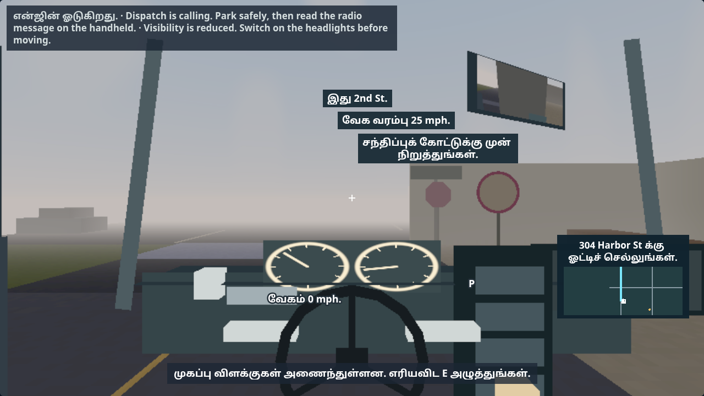
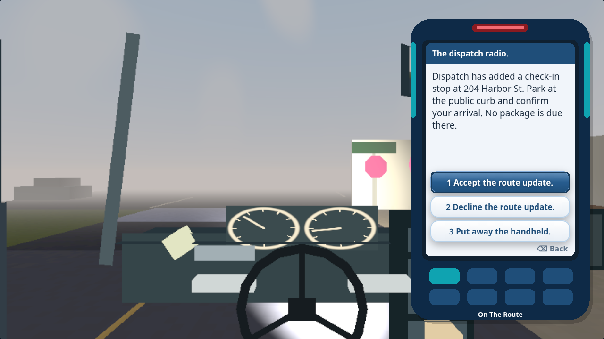
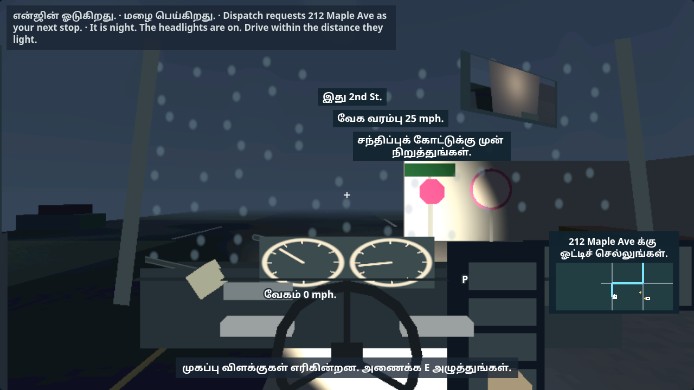

# C-36 dispatch calls and night details

Review evidence is being completed on `codex/c36-radio-night`, now combined with pilot `54d7a63` at `d44c7e6`.
The task stays at review while combined acceptance runs finish.

New workdays from day four receive one captioned dispatch call after twenty metres
of driving. Even days bring an existing delivery forward; odd days add a parked
check-in at a reachable public curb without changing loaded parcels. Responses use
the real handheld and remapped keys. Credit waits for the requested delivery or a
parked arrival confirmation. An ignored call does not block completing the day.
First three days, existing checkpoints and trainer night-off keep their behavior.
[Behavior, report boundaries and shared QA recipe](../../3D-RADIO-NIGHT.md).

Later runs can use night lighting. Headlights extend the visible night range;
oncoming glare uses the existing windscreen and disappears with reduced motion.
A persistent caption warns before moving without headlights in night, dusk, fog
or storms. Incoming calls enter the existing narration queue once, even with sound
effects muted. New English sentences await Claude's translation pass.

| Validation | Result |
| --- | --- |
| Native controls and layout | 243 checks at `7dbc438`, Low English/Tamil normal/larger text plus High English normal and Tamil larger. |
| Final cue correction | 110 real-key checks at `eb13629`, Low Tamil larger and High English normal; once-only narration while muted and daytime fog headlight warning. |
| Final Low page memory | 3,789,531 estimated Phaser bytes, below 4 MiB. |
| Glare pixels | Low 23,102 and High 22,912 changed pixels; reduced motion suppresses the effect. |
| Model and resource boundaries | 212 required/affected Node cases before the cue correction; final 47 affected cases pass. |
| Existing browser behavior | Sound 45, guide 85, keyboard accessibility 145; academy, enterprise, route-day and driving pages pass. Sound repeated after correction: 45 pass. |
| Combined radio/night journeys | 30 days resumed at 3,723 checkpoints; 100-day soak; 240 SCORM score round trips, peak 3,868/4,000. All three adapted cases pass. |
| Syntax and current catalogue | All 19 changed JavaScript files parse; existing translation checks pass. New text awaits extraction/translation by Claude. |
| Full resource gate | Loaded Low passes all 62 views: 54 calls / 2,396 triangles / two textures / 3,557,376 attachment bytes / 3,619,878 Phaser bytes. All 183 views in four profiles pass on `eb13629`; combined 207-view gate running. Original ceilings retained. |
| Shared workday journeys | Earlier batch: seven of nine pass; two debrief timeouts. Combined repeat running. |

[Combined journey probe, scope and results](c36-journeys/manifest.json).
[Final cue captures, reports and hashes](c36-cues/manifest.json).
[Earlier native/resource evidence](c36-native/manifest.json).
[Inherited passes and explicit interruption of the earlier resource run](c36-inherited/manifest.json).

Call arrival and travel are fixtures in native checks; handheld actions, parked
arrival, remapping, narration routing and headlight controls are real. Actual
mission delivery and strict checkpoint tests prove priority credit, wrong-order
failure and report uniqueness. Forty fully configured later-day layouts check
extra curb clearance and routing. Inherited page suites use the existing local
HTTP adapter with unchanged assertions. Cloud resource/pixel measurements leave
Intel frame-rate acceptance to O-1.

Claude merged B-103. The combined four-case probe retains all pins and exact scores
at 3,929–3,995 characters; successful lights still leave only five to seven characters.
[Combined integration, probe and prior failures](c36-merge/).
[All 183 pre-merge resource views](c36-render/manifest.json).
The expanded 207-view gate and all nine shared journeys are being repeated on the
combined build. This is a review handoff, not a completed combined acceptance claim.
