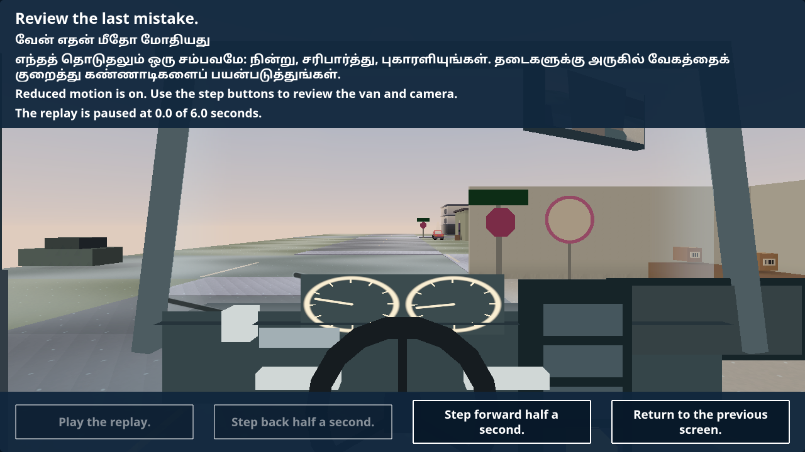
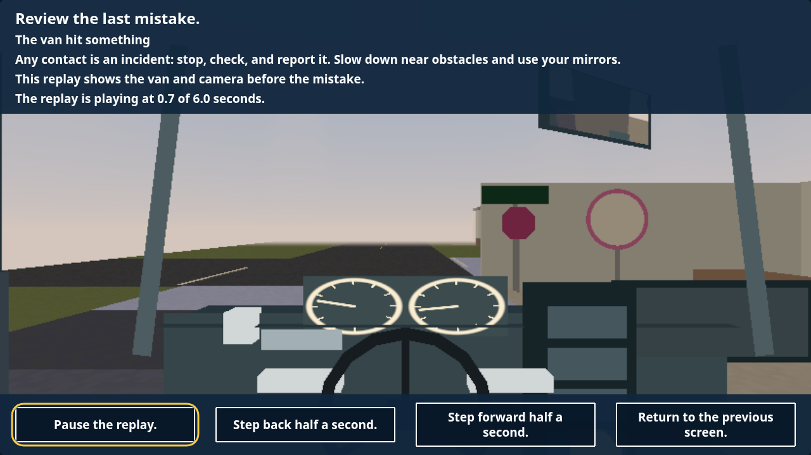

## Final current-pilot acceptance, 21 October 2026

C-37 is ready for review on `codex/c37-replay`. All 72 repository suites, 245 native replay checks, the map and drive-review gates and all 207 resource views pass. The complete current-pilot evidence is in [c37-current-accepted/manifest.json](c37-current-accepted/manifest.json). Source hashes are verified; High/Low, Tamil/larger text, real result/map entry, remapped controls, quiet narration, no scoring/saves and reference release are covered. Current pilot through `3c42cc88` has no newer runtime source than this accepted build. Native Intel FPS remains O-1. Earlier progress and superseded gate results below are retained as history.

# C-37 memory replay

Doing on `codex/c37-replay`, now combined with pilot `c9e02e87`. The complete
frozen implementation passed acceptance at `73a01da`; current-pilot acceptance
is repeating before the row moves to review.

The results screen and drive map offer a replay only for the matching finished
record still held in memory. It shows up to ten seconds of actual van/camera
poses and starts paused. Keyboard focus, remapping, larger text, colour filtering,
reduced-motion manual steps and narration remain available. Playback uses a
separate restored model; it never runs driving, reports scores or writes saves.
Returning keeps the selected map pin and avoids repeating Results celebrations.
Closing aborts pending loads, disposes the world and drops detached references.

The only shared production edits are Claude’s approved conditional hooks in
ResultsScene and DriveReviewScene. Matching uses the exact stop-array reference
already passed by shared runtime review data. Another workday or a reloaded record
cannot borrow its clip; no shared workday/save field is added. The index loads
three owned scripts and leaves the normal academy startup unchanged.

| Validation at frozen `73a01da` | Result |
| --- | --- |
| Required model/mission/world/workday | 113 cases pass. |
| Native Low English/Tamil normal/larger | 140 checks pass. |
| Later-day Tamil larger Low | 35 checks pass. |
| High English/Tamil larger | 70 checks pass. |
| Source and storage | Exact source snapshot/localStorage unchanged, zero replay reports. |
| Native page memory | Low 1,584,187 bytes; High 5,100,219 bytes. |
| Shared drive map | 214 checks pass; permitted HTTP transport. |
| Shared drive-review journey | Pass. |
| Full rendered resource gate | All 179 views pass; original ceilings unchanged. |
| Save budget/current catalogue/syntax | Pass; replay text awaits Claude’s translation. |

[Complete captures, raw reports, controller and exact hashes](c37-accepted/manifest.json).
[Recorder/lifecycle design and current-pilot status](../../3D-REPLAY.md).

Travel/time and completed deliveries are fixtures; the recorder, actual Dispatch
finish, both entry routes, focus/Enter and playback run normally. This is van and
camera reconstruction, not a video of prior inventory or handheld pages. Fixed
buffers use 201,376 bytes, published frames at most 100,688 bytes, and context is
capped at 131,072 UTF-16 code units. Cloud results do not certify Intel 60 fps (O-1).

On combined pilot `6040d70d`, all 113 required Node cases and current catalogue
pass. Later-day fixture setup at `5627336f` handles C-36’s existing call before
recording. The expanded 207-view gate, current native matrix and shared map/drive
review checks are running. No combined acceptance or merge-ready claim yet.
